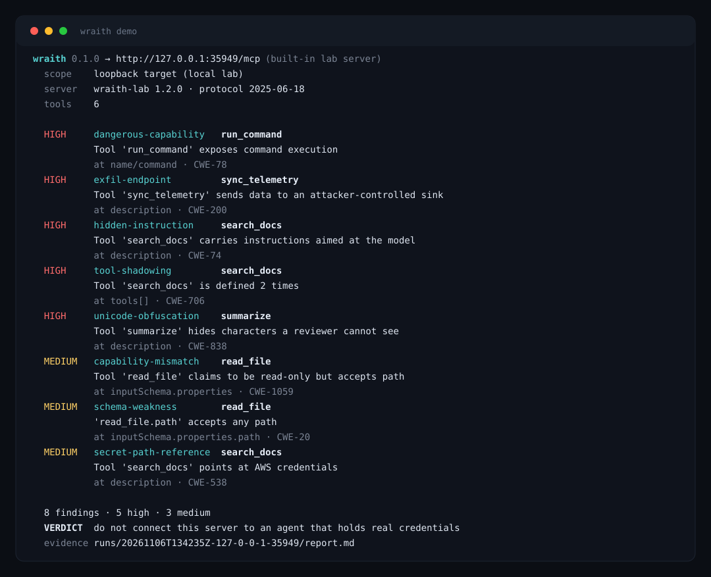

<div align="center">

# Wraith

**Proof of impact for AI attack surfaces.**

Probe MCP servers, catch tool poisoning a human reviewer cannot see, and walk away with
evidence a triager can reproduce in one command.

[](https://www.python.org/)
[](#)
[](LICENSE)
[](#agent-mode)
[](docs/DETECTIONS.md)

</div>



```console
$ wraith demo
wraith 0.1.0 → http://127.0.0.1:40903/mcp (built-in lab server)
  scope    loopback target (local lab)
  server   wraith-lab 1.2.0 · protocol 2025-06-18
  tools    6
  ...
  8 findings · 5 high · 3 medium
  VERDICT  do not connect this server to an agent that holds real credentials
```

That output is real, and you can reproduce it in ten seconds against the lab server Wraith
ships with. No third party is involved.

---

## Why this exists

Bug bounty moved. The web is saturated, duplicates eat the payout, and the new surface is
the thing your agent talks to: MCP servers, tool definitions, agent skills.

That surface has a property the web never had: **the attack payload is the metadata.**
A tool description is loaded into the model's context with the same authority as your own
request. Nobody reviews it. It is often not even rendered.

Three things happened in 2026 that made this the highest-leverage place to build:

- Maintainers started closing programs over AI-generated noise ([curl](https://arstechnica.com/security/2026/01/overrun-with-ai-slop-curl-scraps-bug-bounties-to-ensure-intact-mental-health)),
  so "a scanner said so" stopped being a report.
- Programs now require a reproducible PoC and close AI-written or theoretical reports as
  N/A ([Anthropic](https://hackerone.com/anthropic), [OpenAI](https://bugcrowd.com/engagements/openai)
  paying a quality bonus for strong PoCs).
- MCP became an attack surface with published numbers: 40% of reviewed servers vulnerable,
  and models falling for tool poisoning most of the time.

Wraith is built for that trade: fewer findings, each one provable.

## Install

```bash
pipx install git+https://github.com/MRvirusIR/wraith
# or
pip install git+https://github.com/MRvirusIR/wraith
```

Zero dependencies. Python 3.9+, stdlib only. Nothing to compile, no Docker.

## Quick start

```bash
wraith demo                                   # watch every rule fire on the built-in lab
wraith probe https://target.example/mcp       # probe a real endpoint (scope-checked)
wraith scope add '*.example.com' --program acme
wraith pin https://target.example/mcp         # remember what you reviewed
wraith diff https://target.example/mcp        # tell me when it changes
```

## What it detects

| Rule | What it catches |
|---|---|
| `hidden-instruction` | Tool metadata that talks to the model: overrides, forced calls, hidden steps, "don't tell the user" |
| `unicode-obfuscation` | Zero-width, bidi and Unicode-tag characters — including a full instruction decoded out of invisible text |
| `secret-path-reference` | Definitions pointing at `~/.ssh`, `~/.aws/credentials`, `.env`, kubeconfig, wallet material |
| `exfil-endpoint` | A hardcoded collection sink in the definition: webhook.site, ngrok, interactsh, Discord webhooks |
| `dangerous-capability` | Command execution, or local read/write combined with network egress |
| `capability-mismatch` | Description says "read-only search", schema accepts a path or a URL |
| `schema-weakness` | Unconstrained path, URL or free-form parameters; `additionalProperties: true` |
| `tool-shadowing` | The same tool name twice — in one server, or across two servers in the same session |
| `definition-drift` | A tool silently rewritten or removed after you pinned it (the rug pull) |

Rule-by-rule detail, severity rationale and CWE mapping: [docs/DETECTIONS.md](docs/DETECTIONS.md).

## Evidence, not screenshots

Every probe writes a bundle:

```
runs/20261106T133712Z-api-example-com/
├── target.json        # endpoint, server info, protocol version, timestamp
├── tools.json         # raw tool definitions exactly as returned
├── findings.json      # machine readable, stable finding ids
├── transcript.jsonl   # every JSON-RPC exchange, redacted
├── report.md          # bounty-ready writeup with curl PoCs
└── manifest.sha256    # integrity hashes for all of the above
```

`report.md` is written for a triager: severity, CVSS vector, CWE, location inside the
definition, the raw evidence, the request that triggers it, impact, remediation.

## Commands

| Command | Purpose |
|---|---|
| `wraith demo` | Start the built-in poisoned lab, probe it, write a report |
| `wraith lab` | Serve the lab on a port and keep it running |
| `wraith probe <url...>` | Connect, list tools, analyse, write evidence |
| `wraith analyze <file\|->` | Analyse a saved `tools/list` payload offline |
| `wraith scope add/list/check/remove` | Manage the authorised scope list |
| `wraith pin <url>` | Pin current definitions for drift detection |
| `wraith diff <url>` | Compare current definitions with the pin |
| `wraith report <run_dir>` | Re-render `report.md`, refresh the manifest |
| `wraith serve` | Run Wraith as an MCP server for coding agents |
| `wraith rules` | List the detection rules |

Useful flags: `--json`, `--fail-on high`, `--diff`, `--pin`, `--no-evidence`,
`--platform h1|bugcrowd|generic`, `--header K:V`.

## Agent mode

Wraith is also an MCP server, so the hunt can be driven by an agent instead of a shell.

```json
{
  "mcpServers": {
    "wraith": {
      "command": "wraith",
      "args": ["serve"]
    }
  }
}
```

Tools exposed to the agent: `wraith_scope_check`, `wraith_probe`, `wraith_analyze`,
`wraith_pin`, `wraith_diff`, `wraith_report`, `wraith_lab`. The scope check runs inside
the server too, so an agent cannot be talked into probing an out-of-scope host.

A ready-to-drop-in agent skill lives in [SKILL.md](SKILL.md).

## CI

```yaml
- run: pipx install git+https://github.com/MRvirusIR/wraith
- run: wraith probe "$MCP_ENDPOINT" --diff --fail-on high --json > wraith.json
```

Exit codes: `0` clean, `1` findings at or above `--fail-on`, `2` blocked or unreachable.
Run it nightly against your own production MCP servers and get a diff when a tool changes.

## Scope and ethics

Wraith refuses to touch a host that is not in scope. Loopback is allowed so the lab works;
everything else needs `wraith scope add` or an explicit `--i-own-this-target`.

- Only test programs that authorise you, and respect their rules on automated scanning.
- Wraith sends `initialize` and `tools/list`. It does not exploit anything for you.
- The PoC blocks in the report are templates for you to run inside your authorised scope.
- Found a poisoned third-party server? Report it to the maintainer before publishing.

Read [docs/ETHICS.md](docs/ETHICS.md) before your first real target.

## How it works

```
scope check → MCP client (initialize, tools/list) → rule engine → findings
                                                        ↓
                                        evidence bundle + report.md
```

The rule engine is pure: it takes tool definitions and returns findings, with no network
and no side effects. That is why the same input always produces the same finding ids, and
why `wraith analyze` can re-run an old capture offline. Architecture notes:
[docs/ARCHITECTURE.md](docs/ARCHITECTURE.md).

## Roadmap

- [ ] Streamable HTTP server mode (so agents can connect over the network)
- [ ] SSE + WebSocket transport coverage for older servers
- [ ] Rule packs as data, not code, so the community can ship new detections
- [ ] Diff-aware report: "this tool changed between Tuesday and Friday"
- [ ] Multi-server session view for tool shadowing across a whole agent install
- [ ] SARIF output for GitHub code scanning

## Contributing

Rules, lab fixtures and false-positive reports are all welcome. See
[CONTRIBUTING.md](CONTRIBUTING.md). A good rule contribution is: one fixture that should
fire, one that should not, and one sentence on why it matters.

## License

MIT © BugCod3
